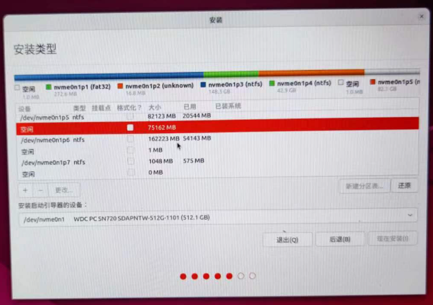
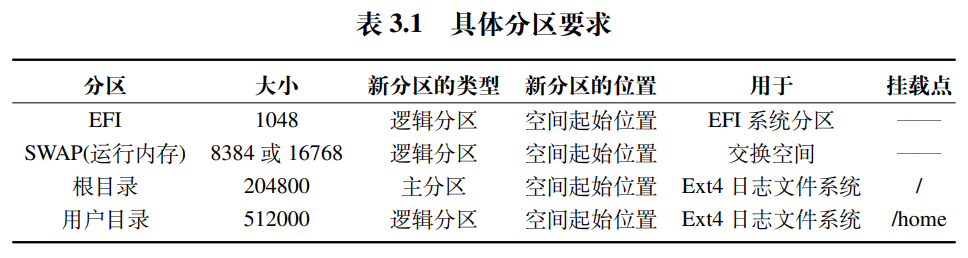

第二次安装ubuntu写下...

# 分区

不懂为什么要分区可以看[链接-分区说明](https://blog.csdn.net/zhanhjxxx/article/details/123232402#:~:text=%E6%9C%AC%E6%96%87%E8%AF%A6%E7%BB%86%E4%BB%8B%E7%BB%8D%E4%BA%86Linux%E7%B3%BB%E7%BB%9F%E4%B8%AD%E7%9A%84%E7%A3%81%E7%9B%98%E7%AE%A1%E7%90%86%EF%BC%8C%E5%8C%85%E6%8B%ACLVM%EF%BC%88%E9%80%BB%E8%BE%91%E5%8D%B7%E7%AE%A1%E7%90%86%E5%99%A8%EF%BC%89%E7%9A%84%E5%9F%BA%E6%9C%AC%E6%A6%82%E5%BF%B5%E3%80%81%E7%A3%81%E7%9B%98%E5%88%86%E5%8C%BA%E3%80%81%E5%88%9B%E5%BB%BA%E7%89%A9%E7%90%86%E5%8D%B7%E3%80%81%E5%8D%B7%E7%BB%84%E3%80%81%E9%80%BB%E8%BE%91%E5%8D%B7%E3%80%81%E6%96%87%E4%BB%B6%E7%B3%BB%E7%BB%9F%E3%80%81%E6%8C%82%E8%BD%BD%E4%BB%A5%E5%8F%8A%E6%89%A9%E5%AE%B9%E5%92%8C%E5%88%A0%E9%99%A4%E6%93%8D%E4%BD%9C%E3%80%82%20%E9%80%9A%E8%BF%87%E5%AE%9E%E4%BE%8B%E6%BC%94%E7%A4%BA%E4%BA%86%E5%A6%82%E4%BD%95%E5%9C%A8%E8%99%9A%E6%8B%9F%E6%9C%BA%E4%B8%AD%E6%B7%BB%E5%8A%A0%E7%A3%81%E7%9B%98%E3%80%81%E5%88%9B%E5%BB%BA%E6%96%B0%E5%88%86%E5%8C%BA%E3%80%81%E8%AE%BE%E7%BD%AE%E7%89%A9%E7%90%86%E5%8D%B7%E3%80%81%E5%8D%B7%E7%BB%84%E3%80%81%E9%80%BB%E8%BE%91%E5%8D%B7%EF%BC%8C%E5%B9%B6%E8%BF%9B%E8%A1%8C%E6%96%87%E4%BB%B6%E7%B3%BB%E7%BB%9F%E6%A0%BC%E5%BC%8F%E5%8C%96%E3%80%81%E6%8C%82%E8%BD%BD%E5%92%8C%E8%87%AA%E5%8A%A8%E6%8C%82%E8%BD%BD%E3%80%82%20%E5%90%8C%E6%97%B6%EF%BC%8C%E4%B9%9F%E9%98%90%E8%BF%B0%E4%BA%86%E5%A6%82%E4%BD%95%E5%AE%89%E5%85%A8%E5%88%A0%E9%99%A4%E5%88%86%E5%8C%BA%EF%BC%8C%E4%BB%A5%E5%8F%8A%E5%A6%82%E4%BD%95%E5%AF%B9%E7%8E%B0%E6%9C%89%E5%88%86%E5%8C%BA%E8%BF%9B%E8%A1%8C%E6%89%A9%E5%AE%B9%E3%80%82,%E5%86%85%E5%AE%B9%E6%B6%B5%E7%9B%96%E4%BA%86%E4%BB%8E%E5%9F%BA%E7%A1%80%E5%88%B0%E8%BF%9B%E9%98%B6%E7%9A%84LVM%E6%93%8D%E4%BD%9C%EF%BC%8C%E9%80%82%E5%90%88%E7%B3%BB%E7%BB%9F%E7%AE%A1%E7%90%86%E5%91%98%E5%92%8C%E8%BF%90%E7%BB%B4%E4%BA%BA%E5%91%98%E5%AD%A6%E4%B9%A0%E3%80%82%20Q%3A%E4%B8%BA%E4%BB%80%E4%B9%88%E8%A6%81%E5%88%86%E5%8C%BA%EF%BC%9F%20%E5%8F%AF%E4%BB%A5%E6%8A%8A%E4%B8%8D%E5%90%8C%E8%B5%84%E6%96%99%EF%BC%8C%E6%94%BE%E5%85%A5%E4%B8%8D%E5%90%8C%E5%88%86%E5%8C%BA%E4%B8%AD%E7%AE%A1%E7%90%86%EF%BC%8C%E9%99%8D%E4%BD%8E%E9%A3%8E%E9%99%A9%EF%BC%9B%E5%A4%A7%E7%A1%AC%E7%9B%98%E6%90%9C%E7%B4%A2%E8%8C%83%E5%9B%B4%E5%A4%A7%EF%BC%8C%E6%95%88%E7%8E%87%E4%BD%8E%EF%BC%9B%E7%A3%81%E7%9B%98%E9%85%8D%E5%90%88%E5%8F%AA%E8%83%BD%E5%AF%B9%E5%88%86%E5%8C%BA%E5%81%9A%E8%AE%BE%E5%AE%9A%EF%BC%9B%E7%BB%8F%E5%B8%B8%E4%BC%9A%E6%93%8D%E4%BD%9C%EF%BC%8C%E5%AE%B9%E6%98%93%E4%BA%A7%E7%94%9F%E7%A2%8E%E7%89%87%E3%80%82)

## 
如下图，在分区时，要从空闲的地方右键点击更改分配空间（空闲空间如果为0，需要把之前在windows上打算用于安装ubuntu的空间如D/E盘删除，比如/dev/nvme0n1p7对应windows上的D盘，将其右键删除！！！前提是这个盘你本来就是分配来安装ubuntu的！！！）

##

下面是分区的具体要求，可以按照倍数分配。

如果是只有一整块硬盘且之前windows已安装，现在装双系统，那么ubuntu可以使用windows的EFI，就不需要再给ubuntu单独再分配EFI；
但是，如果是另外的一整块硬盘用来安装ubuntu，与windows系统分开的硬盘，那么就需要分配EFI。

## 

最后，在最下面-安装启动引导器的设备，要选择整个盘，比如/dev/nvme0n1整块硬盘，而不是/dev/nvme0n1p7 / 6，然后就可以点击开始安装了。

