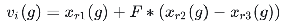
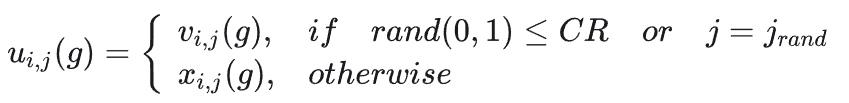
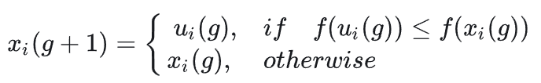

# 基本原理

来源于早期提出的[遗传算法](https://acerfk.github.io/2025/10/24/%E9%81%97%E4%BC%A0%E7%AE%97%E6%B3%95/)，与其不同的是，差分进化算法引入了利用当前群体中个体差异来构造变异个体的差分变异模式，是一种独特的进化方式。

# 算法原理

## 变异
差分进化算法使用种群中两个不同向量来干扰一个现有向量，进行差分操作，来实现变异。在进化过程中，为了保证解有效，必须判断变异个体中各分量是否满足边界条件；若不满足，则变异个体用随机方法生成。



图1-第g代变异个体

其中xr1,xr2,xr3为在种群中随机选择的互不相同个体；F为变异因子,vi为目标个体xi对应的变异个体。

## 交叉
对于每个个体和它所生成的子代变异向量进行交叉，具体的说就是对每个个体按照一定的概率选择子代变异向量（否则不变）来生成新个体。



图2-交叉公式

其中CR为交叉概率因子，j为随机分量

## 选择
使用贪婪算法，根据适应度的值，从目标个体和试验个体中选择更优的作为下一代。



通过上述变异交叉选择操作，种群进化反复循环，直到达到最大迭代次数或达到最优解预定误差精度。

```matlab
function [bestf,bestx,BestCost]  = DE(nPop,MaxIt,VarMin,VarMax,nVar,CostFunction)
%% DE Parameters
% nVar= Number of Decision Variables
VarSize=[1 nVar];   % Decision Variables Matrix Size
% VarMin=Lower Bound of Decision Variables
% VarMax= Upper Bound of Decision Variables
% MaxIt= Maximum Number of Iterations
% nPop= Population Size
beta_min=0.2;   % Lower Bound of Scaling Factor
beta_max=0.8;   % Upper Bound of Scaling Factor
pCR=0.2;        % Crossover Probability
%% Initialization
empty_individual.Position=[];
empty_individual.Cost=[];
BestSol.Cost=inf;
pop=repmat(empty_individual,nPop,1);
for i=1:nPop
    pop(i).Position=unifrnd(VarMin,VarMax,VarSize);
    
    pop(i).Cost=CostFunction(pop(i).Position);
    
    if pop(i).Cost<BestSol.Cost
        BestSol=pop(i);
    end
end
BestCost=zeros(MaxIt,1);
%% DE Main Loop
for it=1:MaxIt
    for i=1:nPop
        x=pop(i).Position;
        A=randperm(nPop);
        A(A==i)=[];
        a=A(1);
        b=A(2);
        c=A(3);
        % Mutation
        %beta=unifrnd(beta_min,beta_max);
        beta=unifrnd(beta_min,beta_max,VarSize);
        y=pop(a).Position+beta.*(pop(b).Position-pop(c).Position);
        y = max(y, VarMin);
		y = min(y, VarMax);
        % Crossover
        z=zeros(size(x));
        j0=randi([1 numel(x)]);
        for j=1:numel(x)
            if j==j0 || rand<=pCR
                z(j)=y(j);
            else
                z(j)=x(j);
            end
        end    
        NewSol.Position=z;
        NewSol.Cost=CostFunction(NewSol.Position);
        
        if NewSol.Cost<pop(i).Cost
            pop(i)=NewSol;
            
            if pop(i).Cost<BestSol.Cost
               BestSol=pop(i);
            end
        end    
    end
    % Update Best Cost
    BestCost(it)=BestSol.Cost;
end
%% Show Results
bestx = BestSol.Position;
bestf = BestCost(end);
end

```