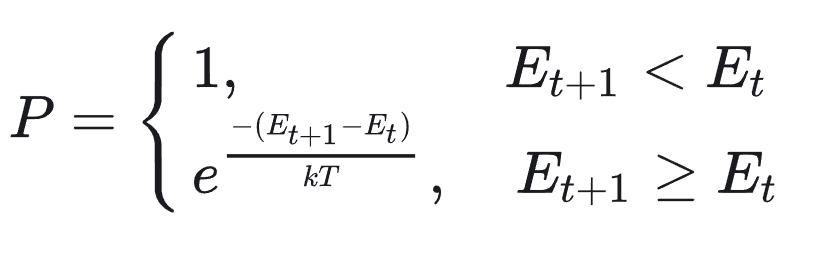
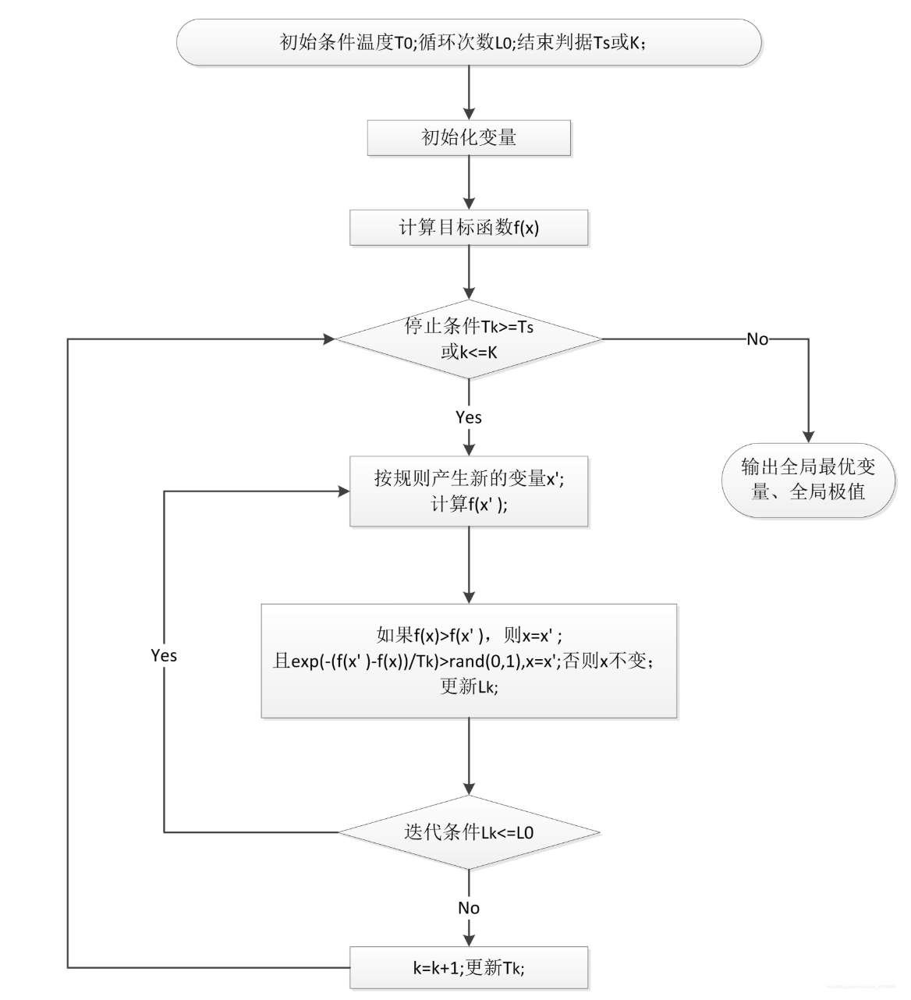

# 基本思想
 
来源于固体退火原理，基于概率的算法。从某一较高初温出发，伴随温度参数的不断下降，结合一定的概率突破特性在解空间中随机寻找目标函数的全局最优解，即在局部最优解能概率性地跳出并最终趋于全局最优。

# 算法原理

结合概率突跳特性在解空间中随机寻找目标函数的全局最优解，更新解的机制-Metropolis准则如下：



其中当前搜索的解为xt，对应的系统能量（目标函数）为Et,对搜索解施加随机扰动，产生新解xt+1，对应的系统能量为Et+1，那么从xt到xt+1的转变的接受概率为以上公式。

# 算法流程



```matlab
%% Simulated Annealing，SA
function [Best_score,Best_pos,curve]=SA(Mmax,l,u,dim,fobj)
% 输入: 
%        fobj = 适应度函数
%        x0 = 输入种群
%        l = 种群下边界
%        u = 种群上边界
%        Mmax = 最大温度
%        TolFun = 优化变化容忍度
% 输出: 
%        x0 = 输出优化后的种群
%        f0 = 输出优化后的种群的适应度值
TolFun = 10E-10;%模拟退火容忍度
x0 = (u-l).*rand(1,dim)+l;%随机初始化模拟退火;
f = fobj;%适应度函数
x=x0;
fx=feval(f,x);%计算适应度值
f0=fx;
count = 1;%用于记录收敛曲线标记
%模拟退火主要步骤
for m=1:Mmax
    T=m/Mmax; %温度
    mu=10^(T*1000);  
    %For each temperature we take 100 test points to simulate reach termal
    for k=0:100
        dx=mu_inv(2*rand(1,dim)-1,mu).*(u-l);
        x1=x+dx;
        %边界处理防止越界
        x1=(x1 < l).*l+(l <= x1).*(x1 <= u).*x1+(u < x1).*u;
        %计算当前位置适应度值和适应度值偏差
        fx1=feval(f,x1);df=fx1-fx;
        % 如果df<0则接受该解，如果大于0 则利用Metropolis准则进行判断是否接受       
        if (df < 0 || rand < exp(-T*df/(abs(fx)+eps)/TolFun))==1
            x=x1;fx=fx1;
        end        
        %判断当前解是否更优，更优则更新.       
        if fx1 < f0 ==1
            x0=x1;f0=fx1;
        end 
    end
     curve(count) = f0;
     count = count+1;
end
Best_pos = x0;
Best_score = f0;
end
%% 新个体
function x=mu_inv(y,mu)
%模拟退火产生新位置偏差
x=(((1+mu).^abs(y)-1)/mu).*sign(y);
end
```