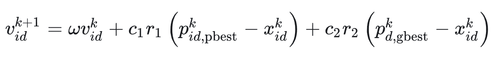
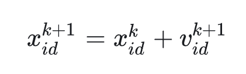

# 基本思想

来源于鸟群觅食，鸟群不知道具体食物地点，只能感受食物大概在哪个位置；但在觅食过程中，所有鸟都共享自己发现食物的位置和食物的数量；每只鸟都会根据自己记忆中的最优位置和种群中的最优位置调整接下来的搜索方向；最终，鸟群会找到全局最优位置。

# 特点
  算法收敛速度快，参数少，简单易实现的优点；容易陷入局部最优解。
# 原理
 
速度更新公式

其中c1为个体学习因子,c2为群体学习因子，r1,r2为随机值，w为权重，Pbest为个体最优值，Gbest为群体最优值



位置更新公式

函数代码：
```matlab
%  定义变量上下界 将ub lb变成向量
ub = ub.*ones(1,dim);
lb = lb.*ones(1,dim);
%  惯性权重最值  
wMax=0.9;
wMin=0.2;
%  c1-自我学习因子(靠近自己历史最好) c2-群体学习因子（靠近群体历史最好）
c1=2;
c2=2;
vMax = (ub - lb) * 0.2;  %最大速度幅度=搜索区间的20%
vMin  = -vMax;  %最小速度幅度

% Initializations
iter=Max_iteration;  %迭代次数
vel=zeros(noP,dim);  %生成noP x dim全零矩阵
pBestScore=zeros(noP); %生成noP x noP全零矩阵
pBest=zeros(noP,dim);
gBest=zeros(1,dim);
cg_curve=zeros(1,iter);
%vel=zeros(noP,dim);
pos=zeros(noP,dim);  %位置

%Initialization
%  初始化粒子的位置和速度
for i=1:size(pos,1)
    for j=1:size(pos,2)
        pos(i,j)=(ub(j)-lb(j))*rand()+lb(j);
        vel(i,j)=rand();
    end
end
%  设置个体和群体最优为正无穷
for i=1:noP
    pBestScore(i)=inf;
end

% Initialize gBestScore for a minimization problem
gBestScore=inf;


for t=1:iter
    for i=1:size(pos,1)
        % 边界处理：把越界的分量直接投回边界上
        % pos(i,:)是第i个粒子的整行位置向量 Flag4ub和Flag4lb为true/false，
        Flag4ub=pos(i,:)>ub;
        Flag4lb=pos(i,:)<lb;
	% ~(Flag4ub+Flag4lb) 先相或再取反，即在位置范围内的向量
        pos(i,:)=(pos(i,:).*(~(Flag4ub+Flag4lb)))+ub.*Flag4ub+lb.*Flag4lb;
        %  计算每个粒子的目标函数值
        fitness=fobj(pos(i,:));
        %  如果个体最小 大于 目标函数值，更新个体最小为目标函数值，同时更新个体最小位置
        if(pBestScore(i)>fitness)
            pBestScore(i)=fitness;
            pBest(i,:)=pos(i,:);
        end
	%  如果全局最小 大于 目标函数值，更新全局最小为目标函数值，同时更新全局最小位置
        if(gBestScore>fitness)
            gBestScore=fitness;
            gBest=pos(i,:);
        end
    end
    
    %  更新惯性权重 线性递减
    w=wMax-t*((wMax-wMin)/iter);
    %  速度和位置更新
    for i=1:size(pos,1)
        for j=1:size(pos,2)
	    %  利用公式计算速度
            vel(i,j)=w*vel(i,j)+c1*rand()*(pBest(i,j)-pos(i,j))+c2*rand()*(gBest(j)-pos(i,j));
            %  速度限幅，[-vMax ,vMax]
            if vel(i,j)>vMax(j)
                vel(i,j)=vMax(j);
            end
            if vel(i,j)<-vMax(j)
                vel(i,j)=-vMax(j);
            end
	    %  利用公式计算位置
            pos(i,j)=pos(i,j)+vel(i,j);
        end
    end
    %  记录收敛曲线
    cg_curve(t)=gBestScore;
end
end
```

注：Python中有开源的PSO算法库，https://github.com/guofei9987/scikit-opt
