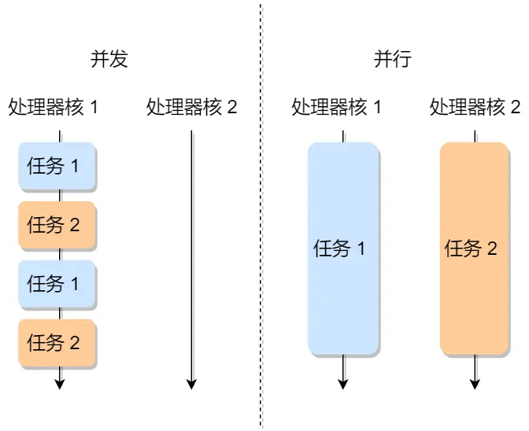
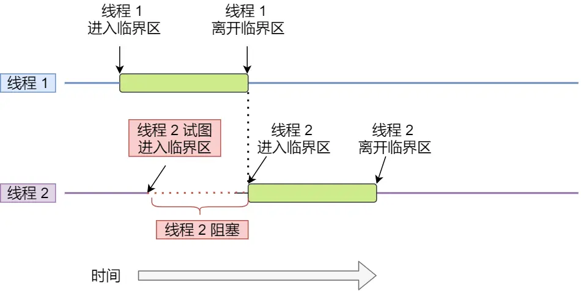

#  进程

代码通过编译后变成二进制可执行文件，当我们运行这个二进制文件时，它会被装载到内存中，CPU会执行程序中的每一条指令，
那么这个运行中的程序就是进程（Process）。

## 并发和并行
 
 

1. 并发：在一个CPU上按顺序执行多个任务

2. 并行：在不同处理器上同时完成不同的任务


## 进程的状态

1. 运行状态（Running）：当前时刻CPU执行该进程

2. 就绪状态（Ready）：因为其他进程处于运行状态而暂停运行

3. 阻塞状态（Blocked）：该进程等待某事件发生而暂停运行

4. 创建状态（New）：进程正在被创建

5. 结束状态（Exit）：进程正在从系统中消失

6. 挂起状态：描述进程没有占用实际物理内存空间的情况

## 进程的控制结构

进程控制块（process control block）：一种数据结构，用来描述进程，
是进程的唯一标识。

包含信息：进程描述信息，进程控制和管理信息，资源分配清单，CPU 相关信息。

组织方式：链表，把具有相同状态的进程链在一起，组成各种队列。

## 进程的控制

1. 创建进程
   
   申请PCB并写入信息--->为进程分配运行时的资源--->将PCB插入到就绪队列，等待被调用

2. 终止进程
   
   查找需要终止进程的PCB--->终止该进程的执行，将对应的CPU资源分配给其他进程--->若有子进程，将其交给1号进程接管--->将全部资源归还操作系统--->把其从PCB所在队列删除

3. 阻塞进程
   
   找到将要被阻塞进程标识号的PCB--->若为运行状态，保护现场，转移为阻塞状态，停止运行--->将该PCB插入到阻塞队列中去

4. 唤醒进程
   
   从阻塞队列中找到相应的PCB--->将其移出，状态置为就绪状态--->把PCB插入到就绪队列，等待调用

## 进程的上下文切换

一个进程切换到另外一个进程

# 线程（Thead）

线程是进程当中一条执行流程，同一进程中的多个线程可以共享代码段、数据段、打开的文件等等资源，但都有独立的寄存器和栈。线程之间可以并发执行。

线程是调度的基本单位，进程是资源拥有的基本单位。

## 线程的上下文切换

当两个线程属于同一个进程，只需切换线程的私有数据、寄存器等不共享的数据。

## 线程的实现

1. 用户线程（User Thread）
   
2. 内核线程

3. 轻量级线程

# 调度

调度程序：操作系统选择一个进程运行

时机：就绪态->运行态，运行态->阻塞态，运行态->结束态

## 调度原则

CPU利用率，系统吞吐量，周转时间，等待时间，响应时间。

## 调度算法

### 先来先服务调度算法

在就绪队列中，先来先运行。

### 最短作业优先调度算法

优先选择时间短的运行。

### 高响应比优先调度算法

按照响应比优先级，从高到低运行

### 时间片轮转调度算法

每个进程分配一个时间段，称为时间片，允许该进程在该时间段中运行。20~50ms

### 最高优先级调度算法

从就绪队列中选取最高优先级的进程进行

### 多级反馈队列调度算法

是时间片轮转和高优先级的组合，

# 进程间通信

插播：linux命令，ps auxf | grep mysql ，竖线|是一个管道，功能是将前一个命令的输出作为后一个命令的输入。

## 管道

匿名管道、命名管道

内核中的一串缓存，传输数据是单向的，一端输入一端输出；双向通信需要创建两个管道。

## 消息队列

保存在内核中的消息链表，但不适合大数据传输。

## 共享内存

设置一块虚拟地址空间，映射到相同的物理内存，这样进程写入的数据，另外一个进程也能看到。

## 信号量

表示资源的数量，整型计数器，用于实现进程间的互斥与同步。信号量初始化为1代表同步信号量，信号量为0代表互斥信号量。

# 多线程

## 互斥

保证一个线程在临界区执行时，其他线程应该被阻止进入临界区



## 同步

并发进程/线程需要互相等待和互通消息，称为进程/线程同步

# 锁

1. 忙等待锁（自旋锁 spin lock）
原子操作：要么全部执行，要么都不执行，不能出现执行到一半的中间状态

测试和置位

```c
int TestAndSet(int * old_ptr,int new){
    int old=*old_ptr;//让old等于old_ptr指向的值
    *old_ptr=new;//让old_ptr指向new
    return old;//返回old
}
typedf struct lock_t{
    int flag;
}lock_t;
void init(lock_t * lock){
    lock->flag=0;
}
void lock(lock_t * lock){
    while(TestAndSet(&lock->flag,1)==1);//等待
}
void unlock(lock_t * lock){
    lock->flag=0;
}
//假设一个线程在运行，调用lock,没有其他线程持有锁，故flag=0;调用函数TestAndSet()最后返回0，此时while判断条件为false，跳出循环，线程获得锁；同时将flag设置为1，锁被持有。当线程离开临界区，调用unlock()将flag清理为0。

//假设一个线程以及持有锁flag=1，另外一个线程调用lock()，此时返回1while一直循环，不做任何事情；直到flag=0，才能获得锁。
```

2. 无等待锁

# 死锁

当两个线程为了保护两个不同的共享资源而使用的两个互斥锁，如果应用不当会造成两个线程都在等待对方释放锁，那么在没有外力的作用下，线程会一直等待，这种称为死锁。

## 产生死锁的条件

1. 互斥条件

    多个线程不能使用同一个资源。

2. 持有并等待条件

3. 不可剥夺条件

    线程已经持有了资源，在使用完之前不能被其他线程获取。    

4. 环路等待条件

    线程A有资源1，想请求资源2，但是资源2为线程B持有，线程B想申请资源1，AB形成资源请求等待的环形。

打破死锁：常见的有使用资源有序分配法，来破坏环路等待条件。


## 读写锁

写锁是独占锁，读锁是多个线程可并发持有


