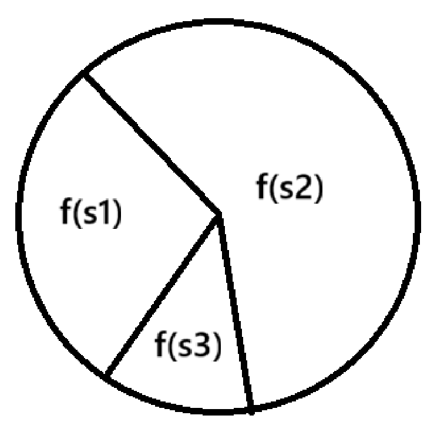

# 基本思想
与遗传学进化中染色体的遗传、交叉、突变和自然选择相关，对于一个最优化问题，一定数量的候选解（称为个体）可抽象表示为染色体，使种群向更好的解进化。进化从完全随机个体的种群开始，之后一代一代发生。在每一代中评价整个种群的适应度，从当前种群中随机地选择多个个体（基于它们的适应度），通过自然选择和突变产生新的生命种群，该种群在算法的下一次迭代中成为当前种群，直到找到最优值。

# 算法流程


算法基本流程

## 编码
一般用二进制编码，比如把变量x=6编码为00110，与后面的交叉、突变有关。对于精度问题，可以用映射，0-5映射为0-256再编码

## 变异
经过编码后，比如x=254编码为0110110，那么变异就是将其中的一位或多位改变（只能变成0或者1），这样种群中就出现了新个体，再反编码回去计算适应度，与其他个体比较，如此会出现较好的变异，对后面的变异有引导作用。

## 交叉
即变量之间互换，x1=01001,x2=01100,可以把x1的01与x2的00互换，这样x1=01000,x2=01101,此时就又出现新个体，与上述操作类似，再次选取优值。


## 选择
适应度轮盘法



把对应所有适应度函数值加起来，再用各自的适应度函数值去除以这个和值，即计算各自的概率，然后再随机生成一个0-1的概率值p，选择在p的范围里的个体。

```matlab
% Genetic Algorithm 遗传算法             %
%_________________________________________________________________________%
function [Best_score,Best_pos,curve]=GA(pop,Max_iter,lb,ub,dim,fobj)
%% 参数初始化
popsize=pop;              %种群规模
lenchrom=dim;              %变量字串长度
fun = fobj;  		%适应度函数
pc=0.8;                  %设置交叉概率
pm=0.05;                  %设置变异概率
if(max(size(ub)) == 1)
   ub = ub.*ones(dim,1);
   lb = lb.*ones(dim,1);  
end
maxgen=Max_iter;   % 进化次数  
%种群
bound=[lb,ub];  %变量范围

%% 产生初始粒子和速度
for i=1:popsize
    %随机产生一个种群
    GApop(i,:)=Code(lenchrom,bound);       %随机产生个体
    %计算适应度
    [fitness(i)]=fun(GApop(i,:));            %染色体的适应度
end

%找最好的染色体
[bestfitness bestindex]=min(fitness);
zbest=GApop(bestindex,:);   %全局最佳
gbest=GApop;                %个体最佳
fitnessgbest=fitness;       %个体最佳适应度值
fitnesszbest=bestfitness;   %全局最佳适应度值
%% 迭代寻优
for i=1:maxgen
%         disp(['第',num2str(i),'次迭代'])
        %种群更新 GA选择更新
        GApop=Select2(GApop,fitness,popsize);

        % 交叉操作 GA
        GApop=Cross(pc,lenchrom,GApop,popsize,bound);

        % 变异操作 GA变异
        GApop=Mutation(pm,lenchrom,GApop,popsize,[i maxgen],bound);

        pop=GApop;
        
      for j=1:popsize
        %适应度值
        [fitness(j)]=fun(pop(j,:));
        %个体最优更新
        if fitness(j) < fitnessgbest(j)
            gbest(j,:) = pop(j,:);
            fitnessgbest(j) = fitness(j);
        end
        
        %群体最优更新
        if fitness(j) < fitnesszbest
            zbest = pop(j,:);
            fitnesszbest = fitness(j);
        end
        
    end
    
    curve(i)=fitnesszbest;     
end
Best_score = fitnesszbest;
Best_pos = zbest;
end
%% 选择函数
function ret=Select2(individuals,fitness,sizepop)
% 本函数对每一代种群中的染色体进行选择，以进行后面的交叉和变异
% individuals input  : 种群信息
% fitness input  : 适应度
% sizepop     input  : 种群规模
% opts        input  : 选择方法的选择
% ret         output : 经过选择后的种群

fitness= 1./(fitness);
sumfitness=sum(fitness);
sumf=fitness./sumfitness;
index=[];
for i=1:sizepop   %转sizepop次轮盘
    pick=rand;
    while pick==0
        pick=rand;
    end
    for j=1:sizepop
        pick=pick-sumf(j);
        if pick<0
            index=[index j];
            break;  %寻找落入的区间，此次转轮盘选中了染色体i，注意：在转sizepop次轮盘的过程中，有可能会重复选择某些染色体
        end
    end
end
individualsTemp=individuals(index,:);
fitnessTemp=fitness(index);
if(size(individualsTemp,1) == 0)
    ret=individuals;
else
    ret=individualsTemp;
end
end
%% 交叉函数
function ret=Mutation(pmutation,lenchrom,chrom,sizepop,pop,bound)
% 本函数完成变异操作
% pcorss                input  : 变异概率
% lenchrom              input  : 染色体长度
% chrom                 input  : 染色体群
% sizepop               input  : 种群规模
% pop                   input  : 当前种群的进化代数和最大的进化代数信息
% ret                   output : 变异后的染色体

for i=1:sizepop  
    % 随机选择一个染色体进行变异
    pick=rand;
    while pick==0
        pick=rand;
    end
    index=ceil(pick*sizepop);
    % 变异概率决定该轮循环是否进行变异
    pick=rand;
    if pick>pmutation
        continue;
    end
    flag=0;
    while flag==0
        % 变异位置
        pick=rand;
        while pick==0
            pick=rand;
        end
        pos=ceil(pick*sum(lenchrom));  %随机选择了染色体变异的位置，即选择了第pos个变量进行变异
        if pos<=0 
            pos = 1;
        end
        if pos>size(bound,1)
            pos = size(bound,1);
        end
        v=chrom(i,pos);
        v1=v-bound(pos,1);
        v2=bound(pos,2)-v;
        pick=rand; %变异开始
        if pick>0.5
            delta=v2*(1-pick^((1-pop(1)/pop(2))^2));
            chrom(i,pos)=v+delta;
        else
            delta=v1*(1-pick^((1-pop(1)/pop(2))^2));
            chrom(i,pos)=v-delta;
        end   %变异结束
        flag=test(lenchrom,bound,chrom(i,:));     %检验染色体的可行性
    end
end
ret=chrom;
end

%% 变异函数
function ret=Cross(pcross,lenchrom,chrom,sizepop,bound)
%本函数完成交叉操作
% pcorss                input  : 交叉概率
% lenchrom              input  : 染色体的长度
% chrom                 input  : 染色体群
% sizepop               input  : 种群规模
% ret                   output : 交叉后的染色体

for i=1:sizepop 
    
    % 随机选择两个染色体进行交叉
    pick=rand(1,2);
    while prod(pick)==0
        pick=rand(1,2);
    end
    index=ceil(pick.*sizepop);
    % 交叉概率决定是否进行交叉
    pick=rand;
    while pick==0
        pick=rand;
    end
    if pick>pcross
        continue;
    end
    flag=0;
    while flag==0
        % 随机选择交叉位置
        pick=rand;
        while pick==0
            pick=rand;
        end
        pos=ceil(pick.*sum(lenchrom)); %随机选择进行交叉的位置，即选择第几个变量进行交叉，注意：两个染色体交叉的位置相同
        pick=rand; %交叉开始
        v1=chrom(index(1),pos);
        v2=chrom(index(2),pos);
        chrom(index(1),pos)=pick*v2+(1-pick)*v1;
        chrom(index(2),pos)=pick*v1+(1-pick)*v2; %交叉结束
        flag1=test(lenchrom,bound,chrom(index(1),:));  %检验染色体1的可行性
        flag2=test(lenchrom,bound,chrom(index(2),:));  %检验染色体2的可行性
        if   flag1*flag2==0
            flag=0;
        else flag=1;
        end    %如果两个染色体不是都可行，则重新交叉
    end
end
ret=chrom;
end
%% 判断是否在范围内
function flag=test(lenchrom,bound,code)
% lenchrom   input : 染色体长度
% bound      input : 变量的取值范围
% code       output: 染色体的编码值

flag=1;
[n,m]=size(code);

for i=1:n
    if code(i)<bound(i,1) || code(i)>bound(i,2)
        flag=0;
    end
end
end
%% 编码函数
function ret=Code(lenchrom,bound)
%本函数将变量编码成染色体，用于随机初始化一个种群
% lenchrom   input : 染色体长度
% bound      input : 变量的取值范围
% ret        output: 染色体的编码值

flag=0;
while flag==0
    pick=rand(1,lenchrom);
    ret=bound(:,1)'+(bound(:,2)-bound(:,1))'.*pick; %线性插值
    flag=test(lenchrom,bound,ret);             %检验染色体的可行性
end
end
```